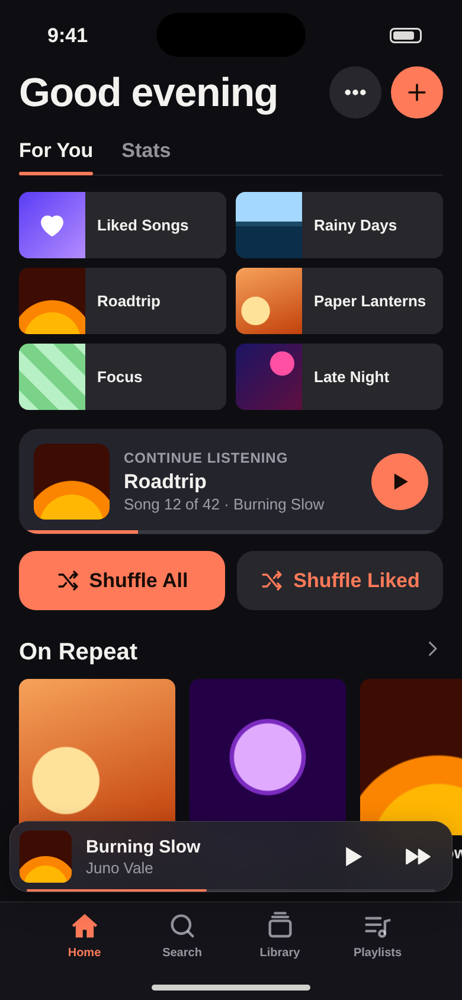
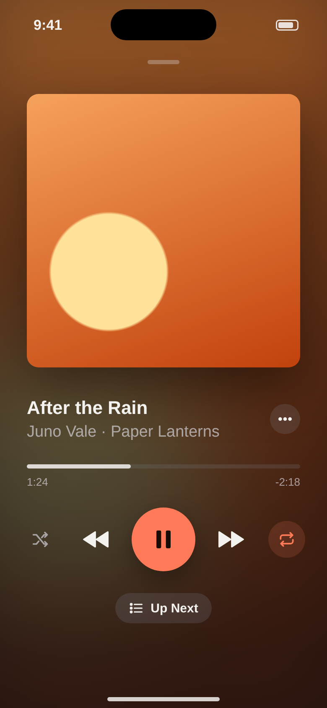
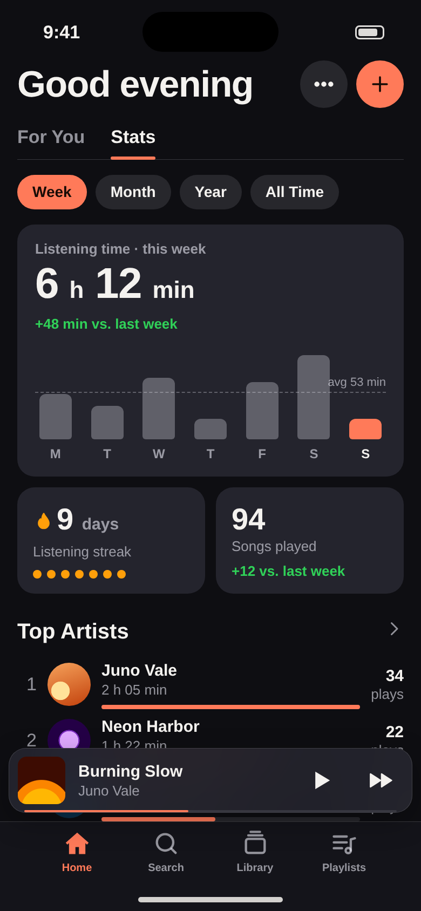
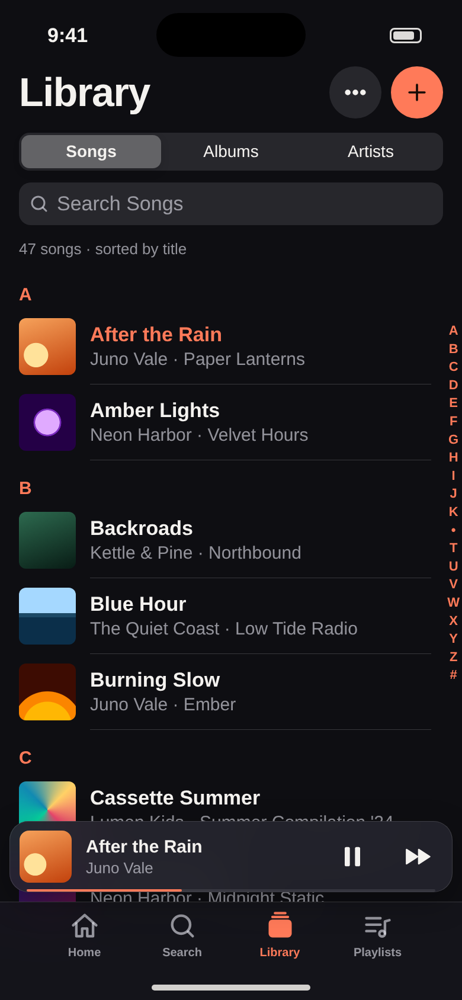
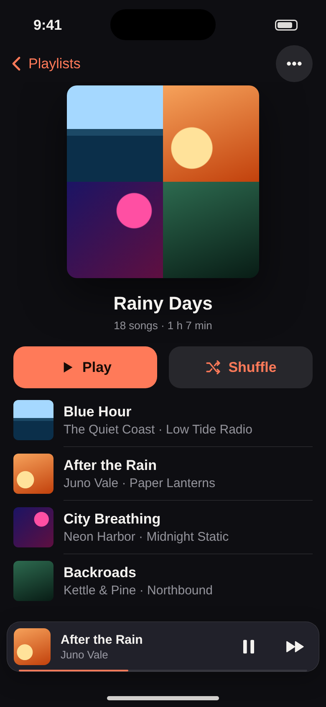
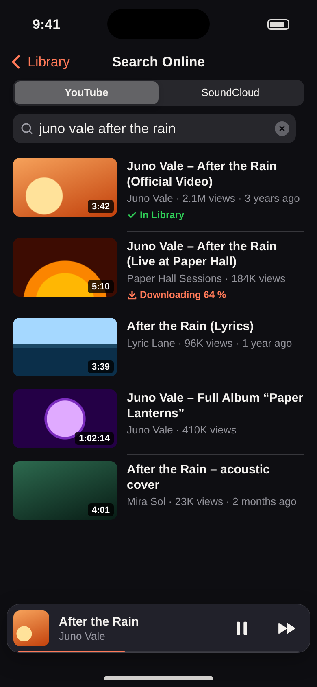
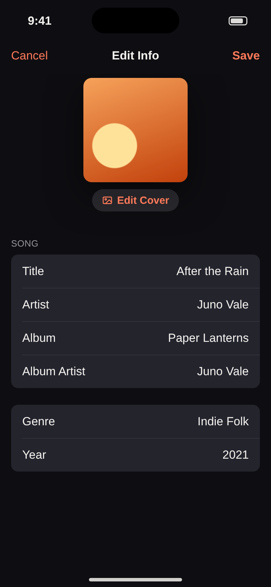

<div align="center">

# 🎧 owntune

**Your music. Your files. Your player.**

A music player for iPhone that plays the songs you own: no account, no subscription, no streaming.

[](https://github.com/shiraayuki/owntune/releases/latest)
[](https://github.com/shiraayuki/owntune/actions/workflows/ci.yml)


[Install](#-install-on-your-iphone) · [Features](#-what-it-can-do) · [FAQ](#-questions--answers) · [Releases](https://github.com/shiraayuki/owntune/releases)

<br>

&nbsp;
&nbsp;


</div>

---

## 🎵 What is owntune?

owntune is a music app for people who still keep **their own music files**, such as MP3s from a CD, a Bandcamp purchase or an old iTunes library. You put the songs into the app once, and from then on everything works **offline**: playing, sorting, building playlists, even editing song details and album covers.

- **No account.** Nobody needs your email address.
- **No subscription.** Nothing is rented, and the songs stay yours.
- **No streaming.** The music lives on your phone, so it also plays in airplane mode or in the subway.
- **No tracking.** The app sends nothing anywhere. The internet is only used when *you* search for a song to download.

> owntune is a hobby project and is not in the App Store. You install it with a free tool called **SideStore**. The guide below explains every step.

---

## ✨ What it can do

<div align="center">
&nbsp;
&nbsp;
&nbsp;

</div>

<br>

| | |
|---|---|
| 📥 **Import your music** | Add MP3, M4A/AAC, FLAC and WAV files from the Files app, many at once. Duplicates are recognised and skipped. |
| 📚 **A tidy library** | Songs, albums and artists are sorted automatically from the song details, with covers. Every list has its own search. |
| ▶️ **A real player** | Full-screen player, mini player on every screen, Up Next queue, repeat and a smart shuffle that does not play the same artist twice in a row. |
| 🔒 **Plays in the background** | Music keeps playing with the screen locked. Lock screen and Control Center show the song and let you pause or skip. |
| 💜 **Liked Songs & playlists** | Tap the heart to like a song. Make playlists with your own cover, then reorder or remove songs any time. |
| 🏠 **Home: For You** | Your recently played albums and playlists, "Continue listening", On Repeat, Recently Added, Rediscover and Never Played. |
| 📊 **Stats** | Listening time per week, month or year, your listening streak, top artists, songs and albums, favourite time of day and your genre mix. |
| ✏️ **Edit song info** | Fix titles, artists, albums and covers, for one song or a whole album at once. Changes are written back into the files. |
| 🔎 **Search online** | Find a song on YouTube Music or YouTube and download it straight into your library, with title, artist and cover. |
| 🌗 **Light & dark** | A calm light design ("Paper") and a dark one ("Midnight") with an accent colour you choose. |

---

## 📲 Install on your iPhone

You need this **once**:

- an **iPhone** (iOS 15 or newer),
- a **computer** (Windows, Mac or Linux) and a USB cable, **only for the first setup**,
- a free **Apple ID** (the one you already use for the App Store is fine).

The setup takes about 20 minutes. After that you never need the computer again.

### Step 1: Install SideStore (one time, with a computer)

SideStore is a free app that installs apps that are not in the App Store. It signs them with your own Apple ID.

1. Open the official guide at **[docs.sidestore.io](https://docs.sidestore.io)**. It has instructions for Windows, Mac and Linux.
2. Follow it until SideStore is on your iPhone and you are signed in with your Apple ID.
3. When the guide asks you to, turn on **Developer Mode** on the iPhone (*Settings → Privacy & Security → Developer Mode*) and restart the phone.

> 💡 This is the longest part. Take your time and follow the SideStore guide exactly. You only have to do it once.

### Step 2: Add owntune to SideStore

1. On the iPhone, **copy** this address (press and hold, then *Copy*):

   ```
   https://github.com/shiraayuki/owntune/releases/latest/download/source.json
   ```

2. Open **SideStore** and go to the **Sources** tab.
3. Tap the **＋** button, **paste** the address and confirm with **Add**.
4. owntune now shows up in that source. Tap it, then tap the install button (it may say **Free** or **Install**).
5. Wait until the installation finishes. owntune appears on your home screen. 🎉

### Step 3: Put your music in

1. Copy your music files to the iPhone, for example into **iCloud Drive** or **On My iPhone** in the *Files* app. AirDrop from a Mac also works.
2. Open **owntune**, tap **＋** at the top right and choose **Import Music**.
3. Select the songs or a whole folder and tap **Open**. owntune copies them into its library and reads the song details and covers.

Prefer to search? Tap **＋ → Search Online**, type a song name and tap **Download**.

### Step 4: Keep it running (every 7 days)

Apps installed with a free Apple ID **stop opening after 7 days** unless they are refreshed. This is an Apple rule, and your music and playlists are not lost when it happens.

- Open **SideStore** at least once a week and tap **Refresh All** in *My Apps*.
- SideStore can also do this automatically in the background. See *Background Refresh* in the SideStore guide.

### Updating owntune

When a new version comes out, SideStore shows an **Update** button next to owntune in *My Apps*. Tap it. Your library stays as it is.

---

## ❓ Questions & answers

**Is it free?**
Yes. owntune and SideStore are both free. A free Apple ID is enough.

**Where is my music stored?**
Inside owntune, on your iPhone. The app keeps its own copy of every imported file, so deleting the original in the Files app does not remove it from owntune.

**What happens when the 7 days run out?**
owntune will not open until you refresh it in SideStore. Nothing is deleted, and after the refresh everything is back as before.

**SideStore says it can't sign in (e.g. "HTTP error 401" or "503").**
This usually comes from SideStore's sign-in servers or from Apple, not from your phone or from owntune. Try another *Anisette Server* in SideStore's settings, or wait a few hours. Apps that are already installed keep working until their 7 days are up.

**Is there an Android version?**
The app is built for Android too, but there is no ready-to-install download yet. It is planned.

**Is downloading from YouTube allowed?**
The download feature is meant for personal use, for songs you have the right to keep. Please respect the rights of artists and your local laws.

**Why is owntune not in the App Store?**
It is a personal project. Publishing in the App Store costs money every year and comes with rules that do not fit features like downloading.

---

## 🛠️ For developers

owntune is written in **Flutter** with a small **Rust** core (via `flutter_rust_bridge` and `lofty`) for reading and writing tags. The database is **drift** (SQLite), state lives in **Riverpod** and playback uses **just_audio** with **audio_service**.

```bash
flutter pub get
flutter run -d linux        # day-to-day development runs as a Linux desktop app
flutter test                # unit and widget tests
flutter test integration_test -d linux   # tests with the real Rust core
```

iOS builds are made only by GitHub Actions. A version tag (`git tag vX.Y.Z && git push --tags`) builds the `.ipa` and publishes a release together with the SideStore source.

[`CLAUDE.md`](CLAUDE.md) covers the architecture, conventions and every command in detail. The designs live in [`docs/mockups/`](docs/mockups/), and specs and plans in [`docs/superpowers/`](docs/superpowers/).

<div align="center">
<br>
<sub>Made with ♥ for people who still own their music.</sub>
</div>
